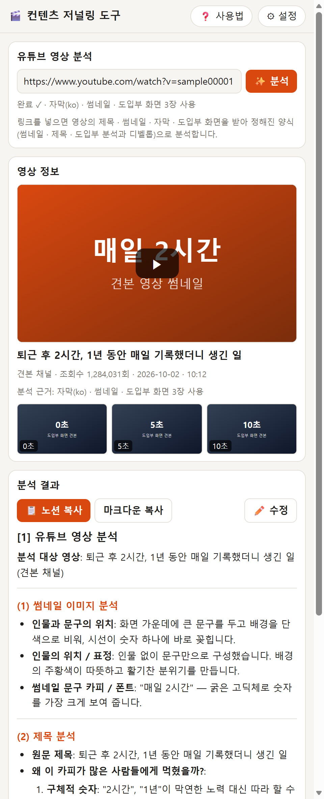
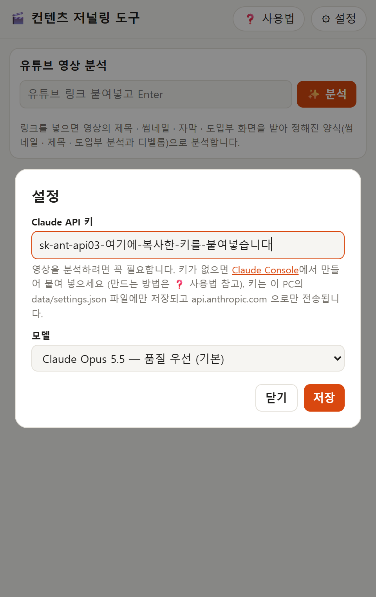
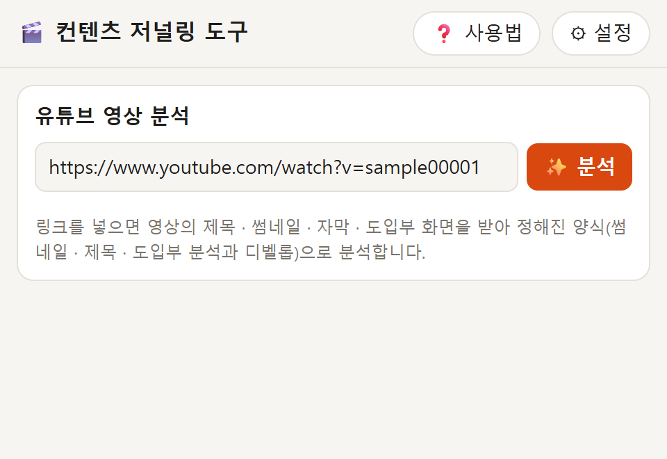

# 컨텐츠 저널링 도구

유튜브 링크를 넣으면 그 영상의 **썸네일 · 제목 · 도입부**를 정해진 양식으로 분석해 주는 도구입니다.
분석 결과는 버튼 하나로 복사해서 노션이나 긱어스에 붙여 넣을 수 있습니다.

설치 프로그램이 따로 없습니다. **내려받아 압축을 풀고 START를 더블클릭**하면 됩니다.

---

## 준비물

| 필요한 것 | 설명 |
|---|---|
| 윈도우 PC | 윈도우 10 또는 11 (64비트) |
| 인터넷 | 처음 실행할 때 필요한 프로그램(약 140MB)을 자동으로 받습니다 |
| Claude API 키 | 분석을 해 주는 AI를 쓰기 위한 열쇠입니다. 유료이며, 만드는 방법은 아래 [4단계](#4단계-claude-api-키-넣기)에 있습니다 |

---

## 설치하기 (처음 한 번만)

### 1단계. 내려받기

아래 링크를 누르면 `content-journaling-main.zip` 파일이 **다운로드** 폴더에 받아집니다.

### 👉 [여기를 눌러 내려받기](https://github.com/aneundev/content-journaling/archive/refs/heads/main.zip)

### 2단계. 압축 풀기

1. **다운로드** 폴더를 엽니다.
2. `content-journaling-main` 파일(지퍼 달린 폴더 모양)을 **마우스 오른쪽 버튼**으로 누릅니다.
3. **압축 풀기...** 를 누르고, 이어서 나오는 창에서 **압축 풀기** 버튼을 누릅니다. (반디집이나 알집을 쓴다면 **여기에 풀기**를 눌러도 됩니다)
4. 새로 생긴 `content-journaling-main` 폴더를 엽니다.

> ⚠ 압축을 풀지 않고 지퍼 폴더 안에서 바로 실행하면 동작하지 않습니다. 꼭 압축을 먼저 풀어 주세요.
>
> 💡 이 폴더를 **바탕 화면**이나 **문서** 폴더로 옮겨 두면 다음에 찾기 쉽습니다. 한 번 실행한 뒤에는 폴더를 통째로 옮겨야 기록이 따라옵니다.

### 3단계. 실행하기

1. 폴더 안의 **START** 파일을 더블클릭합니다. (톱니바퀴가 그려진 아이콘입니다)
2. 보안 경고가 뜨면 아래처럼 눌러 주세요. 처음 한 번만 나옵니다.
   - 파란 창 **"Windows의 PC 보호"** → 글자로 된 **추가 정보**를 누르면 **실행** 버튼이 나타납니다 → **실행**
   - **보안 경고**라고 적힌 작은 창 → **실행**
3. 검은 창이 열리고 준비가 시작됩니다. 처음에는 필요한 프로그램을 자동으로 받느라 **1~3분** 걸립니다. 창을 닫지 말고 기다려 주세요.
4. 준비가 끝나면 브라우저에 도구 화면이 저절로 열립니다.

> ⚠ **검은 창은 도구가 켜져 있다는 뜻입니다.** 쓰는 동안에는 닫지 말고 그대로 두세요(창을 작게 내려 두어도 됩니다). 검은 창을 닫으면 도구가 꺼집니다.

### 4단계. Claude API 키 넣기

처음 열면 설정 창이 떠 있습니다. 여기에 Claude API 키를 넣어야 분석할 수 있습니다.

**Claude API 키 만드는 방법**

1. <https://platform.claude.com> 에 들어가 가입하거나 로그인합니다. (Claude Console이라는 곳입니다)
2. **크레딧 충전** — <https://platform.claude.com/settings/billing> 에서 **Buy credits**를 누르고 금액을 정해 결제합니다. 분석할 때마다 여기서 사용료가 빠져나갑니다.
3. **키 만들기** — <https://platform.claude.com/settings/keys> 에서 **Create key**를 누르고, 이름을 아무거나 적은 뒤(예: `저널링`) 만듭니다.
4. `sk-ant-`로 시작하는 긴 글자가 나옵니다. 이것이 키입니다. **복사** 버튼을 눌러 복사합니다.
   - 키는 이때 **딱 한 번만** 보여 줍니다. 놓쳤으면 새로 만들면 됩니다.
5. 도구의 설정 창으로 돌아와 **Claude API 키** 칸을 누르고 `Ctrl + V`로 붙여 넣은 뒤 **저장**을 누릅니다.

> 🔒 키는 비밀번호와 같습니다. 다른 사람에게 보여 주거나 메신저에 올리지 마세요. 키를 아는 사람은 내 크레딧을 쓸 수 있습니다.
>
> 💰 충전한 크레딧은 구매한 날부터 1년이 지나면 사라지고 환불되지 않으니, 처음에는 적은 금액으로 시작하세요.

설치는 여기까지입니다. 🎉

---

## 사용하기

1. 유튜브에서 분석할 영상을 열고 **주소를 복사**합니다. (주소창의 주소를 복사하거나, 영상 아래 **공유 → 복사**)
2. 도구의 **유튜브 링크** 칸에 붙여 넣고 **✨ 분석**을 누릅니다. (Enter를 눌러도 됩니다)
3. 영상 정보를 받고 분석 글을 쓰는 데 **1~2분** 걸립니다. 글이 써지는 모습이 화면에 보입니다.
4. 다 되면 **📋 노션 복사**를 누르고, 노션 페이지나 긱어스 글쓰기 화면에서 `Ctrl + V`로 붙여 넣습니다.

**그 밖의 버튼**

| 버튼 | 하는 일 |
|---|---|
| ✏️ 수정 | 분석 글을 직접 고칩니다. 고친 내용은 자동으로 저장됩니다 |
| 마크다운 복사 | 서식 기호가 들어간 글 그대로 복사합니다 |
| ■ 중단 | 분석하는 도중에 멈춥니다 (분석 버튼이 이 버튼으로 바뀝니다) |
| 최근 분석 | 화면 아래 목록에서 예전에 분석한 영상을 눌러 다시 봅니다. **×**를 누르면 지웁니다 (최근 50개까지 보관) |
| ⚙ 설정 | API 키를 바꾸거나 모델을 고릅니다 |

---

## 끄기와 다시 켜기

- **끄기** — 검은 창을 닫습니다(오른쪽 위 **X**). 브라우저 탭도 닫으면 됩니다.
- **다시 켜기** — 폴더의 **START**를 더블클릭합니다. 두 번째부터는 몇 초면 열립니다.
- **바탕 화면에서 바로 켜기** — START 파일을 마우스 오른쪽 버튼으로 누르고 **보내기 → 바탕 화면(바로 가기 만들기)** 를 고릅니다. (윈도우 11에서는 먼저 **추가 옵션 표시**를 눌러야 **보내기**가 보입니다)

---

## 잘 안 될 때

| 이런 일이 생기면 | 이렇게 해 보세요 |
|---|---|
| "Windows의 PC 보호" 창에 **실행** 버튼이 없다 | 창 안의 **추가 정보** 글자를 누르면 **실행** 버튼이 나타납니다 |
| START를 눌러도 막히거나 아무 일도 일어나지 않는다 | 내려받은 zip 파일을 마우스 오른쪽 버튼으로 눌러 **속성**을 열고, 맨 아래 **차단 해제**에 체크한 뒤 **확인**을 누릅니다. 그다음 압축을 다시 풀어 실행합니다 |
| 검은 창이 잠깐 떴다가 바로 사라진다 | 압축을 풀지 않고 실행했는지 확인합니다 ([2단계](#2단계-압축-풀기)) |
| 검은 창에 "받지 못했습니다"라고 나온다 | 인터넷 연결을 확인한 뒤 검은 창을 닫고 START를 다시 실행합니다. 회사 · 학교 인터넷은 내려받기가 막혀 있을 수 있으니 집 인터넷이나 휴대폰 핫스팟으로 해 보세요 |
| 백신 프로그램이 `yt-dlp.exe`나 `ffmpeg.exe`를 막았다 | 유튜브 영상 정보를 받는 데 쓰는 프로그램입니다. 백신에서 **허용**(예외 등록)한 뒤 START를 다시 실행합니다 |
| 브라우저 화면이 저절로 열리지 않는다 | 검은 창에 나온 주소(보통 `http://localhost:4780`)를 크롬이나 엣지 주소창에 직접 넣습니다 |
| "검은 창(START)이 꺼져 있어 연결할 수 없습니다" | START를 다시 더블클릭한 뒤 도구 화면에서 `F5`를 누릅니다 |
| "API 키가 올바르지 않습니다" | ⚙ 설정에서 키를 지우고 다시 붙여 넣습니다. 앞뒤가 잘리지 않게 전체를 복사했는지 확인하세요 |
| "API 오류"와 함께 credit(크레딧)이라는 말이 나온다 | 크레딧이 떨어진 것입니다. <https://platform.claude.com/settings/billing> 에서 충전합니다 |
| "요청 한도를 넘었습니다" | 잠시 기다렸다가 다시 분석합니다 |
| "영상 정보를 가져오지 못했습니다" | 링크가 맞는지 확인합니다. 비공개 · 삭제된 영상, 로그인해야 볼 수 있는 영상은 분석할 수 없습니다. 다른 영상도 계속 안 되면 검은 창을 닫고 START를 다시 실행해 보세요 |
| 분석 결과에 "자막을 받을 수 없어 확인하지 못했습니다"라고 나온다 | 자막이 없는 영상입니다. 썸네일과 제목 분석은 그대로 쓸 수 있습니다 |

---

## 자주 묻는 것

**돈이 드나요?**
도구 자체는 무료입니다. 분석할 때마다 Claude API 사용료가 내 크레딧에서 빠집니다. 얼마나 썼는지는 <https://platform.claude.com/settings/billing> 에서 볼 수 있습니다. ⚙ 설정에서 모델을 **Sonnet**이나 **Haiku**로 바꾸면 사용료가 줄어듭니다.

**내 기록은 어디에 저장되나요?**
이 폴더 안의 `data` 폴더에만 저장됩니다. 분석 기록과 API 키가 들어 있으니 `data` 폴더는 남에게 주지 마세요. `data` 폴더를 복사해 두면 그것이 백업입니다.

**내 정보가 밖으로 나가나요?**
분석할 때 그 영상의 정보(제목 · 자막 · 썸네일 · 도입부 화면)가 Claude API(`api.anthropic.com`)로 전송됩니다. API 키와 분석 기록은 이 PC에만 있습니다.

**처음 실행할 때 무엇을 받나요?**
세 가지 프로그램을 이 폴더 안의 `bin` 폴더에 받습니다. PC의 다른 곳에는 아무것도 설치하지 않습니다.

| 프로그램 | 하는 일 | 받는 곳 |
|---|---|---|
| Node.js | 도구를 실행합니다 | nodejs.org |
| yt-dlp | 유튜브 영상의 제목 · 자막을 받습니다 | github.com/yt-dlp/yt-dlp |
| ffmpeg | 영상 도입부 화면을 캡처합니다 | github.com/eugeneware/ffmpeg-static |

**새 버전이 나오면 어떻게 바꾸나요?**
[1단계](#1단계-내려받기)부터 다시 해서 새 폴더를 만든 뒤, 예전 폴더 안의 `data` 폴더와 `bin` 폴더를 새 폴더 안으로 옮기면 됩니다. 기록과 설정이 그대로 이어집니다.

**지우려면 어떻게 하나요?**
`content-journaling-main` 폴더를 통째로 지우면 끝입니다.

---

## 긱어스에 바로 올리기 (선택)

Aside 브라우저와 Aside CLI가 설치된 PC에서는 분석 결과 위에 **🚀 긱어스에 올리기** 버튼이 나타납니다. 누르면 AG 마스터마인드의 **컨텐츠저널링** 카테고리에 글이 올라가고, 글 맨 위에 유튜브 영상이 들어갑니다.

- ⚙ 설정에 **기수**와 **이름**을 넣어야 합니다. 글 제목이 `51기 홍길동 컨텐츠 저널링 - 영상 제목` 형태로 만들어집니다.
- Aside 브라우저에서 긱어스에 로그인돼 있어야 합니다. 설정에 긱어스 이메일과 비밀번호를 넣어 두면 로그인이 풀렸을 때 자동으로 로그인합니다.
- Aside CLI 설치: Aside 설정 → Developers → Install

Aside가 없으면 이 버튼은 보이지 않습니다. 그때는 **📋 노션 복사**로 복사해 긱어스 글쓰기 화면에 붙여 넣으면 됩니다.

---

## 개발자용

- 구성: `START.bat`(실행), `server.js`(로컬 서버, 추가 패키지 없음), `index.html`(화면)
- Node.js 20 이상이 PC에 설치돼 있으면 그것을 쓰고, 없으면 `bin/node.exe`를 받아서 씁니다. yt-dlp와 ffmpeg도 PC에 설치된 것이 있으면 그것을 씁니다.
- 직접 실행: `node server.js --open`

| 환경변수 | 뜻 | 기본값 |
|---|---|---|
| `PORT` | 서버 포트. 사용 중이면 다음 번호를 차례로 시도합니다 | `4780` |
| `CJ_DATA_DIR` | 기록을 저장할 폴더 | 이 폴더의 `data` |
| `CJ_NO_OPEN` | `1`이면 브라우저를 열지 않습니다 | |
